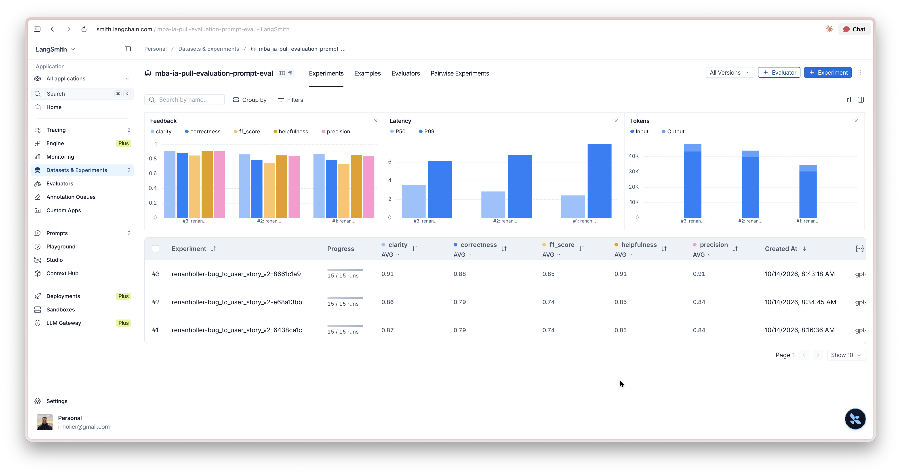
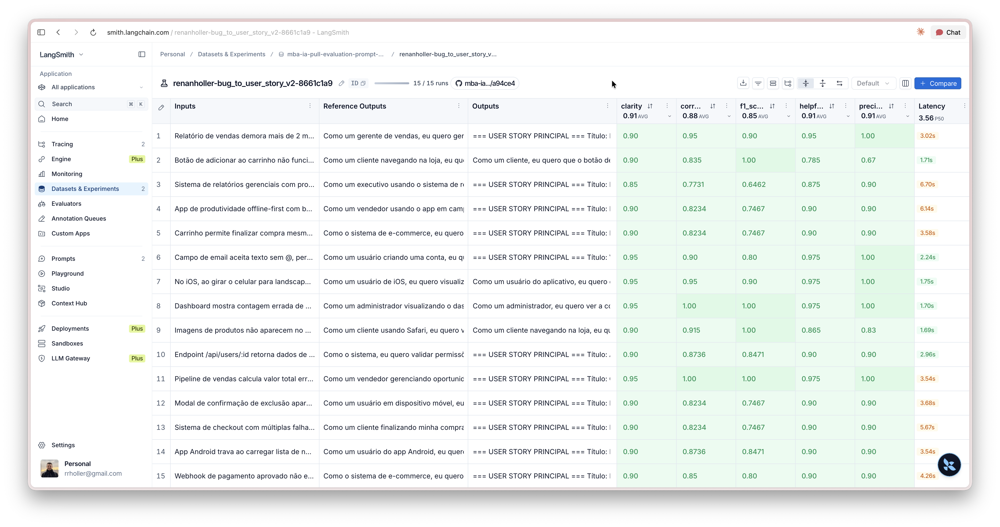

# Pull, Otimização e Avaliação de Prompts com LangChain e LangSmith

## Objetivo

Você deve entregar um software capaz de:

- Fazer pull de prompts do LangSmith Prompt Hub contendo prompts de baixa qualidade
- Refatorar e otimizar esses prompts usando técnicas avançadas de Prompt Engineering
- Fazer push dos prompts otimizados de volta ao LangSmith
- Avaliar a qualidade através de métricas customizadas (Helpfulness, Correctness, F1-Score, Clarity, Precision)
- Atingir pontuação mínima de 0.8 (80%) em todas as métricas de avaliação

## Exemplo no CLI

Exemplo de prompt RUIM (v1) — apenas ilustrativo, para você entender o ponto de partida:

```
==================================================
Prompt: {seu_username}/bug_to_user_story_v1
==================================================

Métricas Derivadas:
  - Helpfulness: 0.45 ✗
  - Correctness: 0.52 ✗

Métricas Base:
  - F1-Score: 0.48 ✗
  - Clarity: 0.50 ✗
  - Precision: 0.46 ✗

❌ STATUS: REPROVADO
⚠️  Métricas abaixo de 0.8: helpfulness, correctness, f1_score, clarity, precision
```

Exemplo de prompt OTIMIZADO (v2) — seu objetivo é chegar aqui:

```
# Após refatorar os prompts e fazer push
python src/push_prompts.py

# Executar avaliação
python src/evaluate.py

Executando avaliação dos prompts...
==================================================
Prompt: {seu_username}/bug_to_user_story_v2
==================================================

Métricas Derivadas:
  - Helpfulness: 0.94 ✓
  - Correctness: 0.96 ✓

Métricas Base:
  - F1-Score: 0.93 ✓
  - Clarity: 0.95 ✓
  - Precision: 0.92 ✓

✅ STATUS: APROVADO - Todas as métricas >= 0.8

Resultados no LangSmith (notas gravadas como feedback no experimento):
  {seu_username}/bug_to_user_story_v2
    https://smith.langchain.com/o/.../datasets/.../compare?selectedSessions=...
```

## Tecnologias obrigatórias

- Linguagem: Python 3.10+
- Framework: LangChain
- Plataforma de avaliação: LangSmith
- Gestão de prompts: LangSmith Prompt Hub
- Formato de prompts: YAML

## Pacotes recomendados

```python
from langsmith import Client  # Pull/push de prompts, datasets e avaliação
from langchain_core.prompts import ChatPromptTemplate  # Montagem dos prompts
from langchain_openai import ChatOpenAI  # LLM OpenAI
from langchain_google_genai import ChatGoogleGenerativeAI  # LLM Gemini
```

## OpenAI

- Crie uma API Key da OpenAI: https://platform.openai.com/api-keys
- Você vai precisar de um modelo de LLM para responder e de um modelo de LLM para avaliação. Consulte a documentação oficial da OpenAI para ver os modelos disponíveis.
- Custo estimado: ~$1-5 para completar o desafio

## Gemini (modelo free)

- Crie uma API Key da Google: https://aistudio.google.com/app/apikey
- Você vai precisar de um modelo de LLM para responder e de um modelo de LLM para avaliação. Consulte a documentação oficial do Google para ver os modelos disponíveis.
- Os limites de requisições gratuitas mudam com frequência. Consulte os limites atuais na documentação oficial do Google.

## Escolha dos modelos

Este desafio não fixa modelos. Nomes e versões mudam com frequência e alguns são descontinuados, então faz parte do desafio consultar a documentação oficial do provedor que você escolher, ver quais modelos estão disponíveis no momento e selecionar os que atendem ao objetivo. Você pode usar o mesmo modelo para responder e para avaliar, ou um modelo mais capaz na avaliação.

## Handle do LangSmith Hub (seu username)

O LangSmith identifica os prompts que você publica por um **handle público**, no
formato `handle/nome_do_prompt`. Esse handle é o valor que vai em
`USERNAME_LANGSMITH_HUB` no `.env`.

Ele **não existe por padrão**: é criado no momento em que você torna um prompt
público pela primeira vez. Por isso, faça esta etapa antes de tentar o push:

1. Abra o LangSmith e vá em **Prompts**
2. Crie um prompt qualquer (pode ser de teste) ou abra um que você já tenha
3. Clique nos **três pontinhos** no canto superior direito, ao lado do botão **Playground**
4. Escolha **Make Public**
5. Na tela **Choose your public handle**, defina o seu handle

O handle é **definitivo** depois de confirmado, então escolha com calma. Feito
isso, ele aparece no endereço do prompt (`handle/nome_do_prompt`) e é esse valor
que você coloca no `.env`.

## Requisitos

### 1. Pull do Prompt inicial do LangSmith

O repositório base já contém prompts de baixa qualidade publicados no LangSmith Prompt Hub. Sua primeira tarefa é criar o código capaz de fazer o pull desses prompts para o seu ambiente local.

Tarefas:

- Criar seu handle do LangSmith Hub (ver a seção "Handle do LangSmith Hub" acima)
- Configurar suas credenciais do LangSmith no arquivo .env (conforme o arquivo .env.example)
- Implementar o script src/pull_prompts.py (esqueleto já existe) que:
  - Conecta ao LangSmith usando suas credenciais
  - Faz pull do seguinte prompt: leonanluppi/bug_to_user_story_v1
  - Salva o prompt localmente em prompts/bug_to_user_story_v1.yml

Atenção: o LangSmith bloqueia por padrão o pull de prompts identificados por
`owner/nome`, porque um prompt do Hub é um objeto LangChain serializado e pode vir
de terceiros. Para o prompt semente do desafio, passe `dangerously_pull_public_prompt=True`
no `client.pull_prompt(...)`.

### 2. Otimização do Prompt

Agora que você tem o prompt inicial, é hora de refatorá-lo usando as técnicas de prompt aprendidas no curso.

Tarefas:

- Analisar o prompt em prompts/bug_to_user_story_v1.yml
- Criar um novo arquivo prompts/bug_to_user_story_v2.yml com suas versões otimizadas
- Aplicar obrigatoriamente Few-shot Learning (exemplos claros de entrada/saída) e pelo menos uma das seguintes técnicas adicionais:
  - Chain of Thought (CoT): Instruir o modelo a "pensar passo a passo"
  - Tree of Thought: Explorar múltiplos caminhos de raciocínio
  - Skeleton of Thought: Estruturar a resposta em etapas claras
  - ReAct: Raciocínio + Ação para tarefas complexas
  - Role Prompting: Definir persona e contexto detalhado
- Documentar no README.md quais técnicas você escolheu e por quê

Requisitos do prompt otimizado:

- Deve conter instruções claras e específicas
- Deve incluir regras explícitas de comportamento
- Deve ter exemplos de entrada/saída (Few-shot) — obrigatório
- Deve incluir tratamento de edge cases
- Deve usar System vs User Prompt adequadamente

### 3. Push e Avaliação

Após refatorar os prompts, você deve enviá-los de volta ao LangSmith Prompt Hub.

Tarefas:

- Implementar o script src/push_prompts.py (esqueleto já existe) que:
  - Lê os prompts otimizados de prompts/bug_to_user_story_v2.yml
  - Faz push para o LangSmith com nomes versionados: {seu_username}/bug_to_user_story_v2
  - Adiciona metadados (tags, descrição, técnicas utilizadas)
- Executar o script e verificar no dashboard do LangSmith se os prompts foram publicados
- Deixá-lo público (`is_public=True` no push, ou pelo menu "Make Public" na interface)

Lembre-se de que `{seu_username}` é o handle do Hub, e ele só existe depois de você
ter tornado algum prompt público pelo menos uma vez.

### 4. Iteração

Espera-se 3-5 iterações.

- Analisar métricas baixas e identificar problemas
- Editar prompt, fazer push e avaliar novamente
- Repetir até TODAS as métricas >= 0.8

Cada execução do `src/evaluate.py` cria um **experimento** no LangSmith, ligado ao
dataset de avaliação. As 5 notas são gravadas como feedback em cada exemplo, o que
permite comparar suas iterações lado a lado no dashboard. Ao final, o script imprime
o link direto do experimento.

```
Critério de Aprovação:
- Helpfulness >= 0.8
- Correctness >= 0.8
- F1-Score >= 0.8
- Clarity >= 0.8
- Precision >= 0.8

MÉDIA das 5 métricas >= 0.8
```

IMPORTANTE: TODAS as 5 métricas devem estar >= 0.8, não apenas a média!

### 5. Testes de Validação

O que você deve fazer: Edite o arquivo tests/test_prompts.py e implemente, no mínimo, os 6 testes abaixo usando pytest:

- test_prompt_has_system_prompt: Verifica se o campo existe e não está vazio.
- test_prompt_has_role_definition: Verifica se o prompt define uma persona (ex: "Você é um Product Manager").
- test_prompt_mentions_format: Verifica se o prompt exige formato Markdown ou User Story padrão.
- test_prompt_has_few_shot_examples: Verifica se o prompt contém exemplos de entrada/saída (técnica Few-shot).
- test_prompt_no_todos: Garante que você não esqueceu nenhum [TODO] no texto.
- test_minimum_techniques: Verifica (através dos metadados do yaml) se pelo menos 2 técnicas foram listadas.

Como validar:

```
pytest tests/test_prompts.py
```

## Estrutura obrigatória do projeto

Faça um fork do repositório base: https://github.com/devfullcycle/mba-ia-pull-evaluation-prompt

```
mba-ia-pull-evaluation-prompt/
├── .env.example              # Template das variáveis de ambiente
├── requirements.txt          # Dependências Python
├── README.md                 # Sua documentação do processo
│
├── prompts/
│   ├── bug_to_user_story_v1.yml  # Prompt inicial (já incluso)
│   └── bug_to_user_story_v2.yml  # Seu prompt otimizado (criar)
│
├── datasets/
│   └── bug_to_user_story.jsonl   # 15 exemplos de bugs (já incluso)
│
├── src/
│   ├── pull_prompts.py       # Pull do LangSmith (implementar)
│   ├── push_prompts.py       # Push ao LangSmith (implementar)
│   ├── evaluate.py           # Avaliação automática (pronto)
│   ├── metrics.py            # 5 métricas implementadas (pronto)
│   └── utils.py              # Funções auxiliares (pronto)
│
├── tests/
│   └── test_prompts.py       # Testes de validação (implementar)
```

O que você deve implementar:

- prompts/bug_to_user_story_v2.yml — Criar do zero com seu prompt otimizado
- src/pull_prompts.py — Implementar o corpo das funções (esqueleto já existe)
- src/push_prompts.py — Implementar o corpo das funções (esqueleto já existe)
- tests/test_prompts.py — Implementar os 6 testes de validação (esqueleto já existe)
- README.md — Documentar seu processo de otimização

O que já vem pronto (não alterar):

- src/evaluate.py — Script de avaliação completo (cria o experimento no LangSmith e grava as notas como feedback)
- src/metrics.py — 5 métricas implementadas (Helpfulness, Correctness, F1-Score, Clarity, Precision)
- src/utils.py — Funções auxiliares
- datasets/bug_to_user_story.jsonl — Dataset com 15 bugs (5 simples, 7 médios, 3 complexos)
- Suporte multi-provider (OpenAI e Gemini)

## VirtualEnv para Python

Crie e ative um ambiente virtual antes de instalar dependências:

```
python3 -m venv venv
source venv/bin/activate  # No Windows: venv\Scripts\activate
pip install -r requirements.txt
```

## Ordem de execução

1. Executar pull dos prompts ruins

```
python src/pull_prompts.py
```

2. Refatorar prompts

Edite manualmente o arquivo prompts/bug_to_user_story_v2.yml aplicando as técnicas aprendidas no curso.

3. Fazer push dos prompts otimizados

```
python src/push_prompts.py
```

4. Executar avaliação

```
python src/evaluate.py
```

## Entregável

1. Repositório público no GitHub (fork do repositório base) contendo:

- Todo o código-fonte implementado
- Arquivo prompts/bug_to_user_story_v2.yml 100% preenchido e funcional
- Arquivo README.md atualizado

2. README.md deve conter:

A) Seção "Técnicas Aplicadas (Fase 2)":

- Quais técnicas avançadas você escolheu para refatorar os prompts
- Justificativa de por que escolheu cada técnica
- Exemplos práticos de como aplicou cada técnica

B) Seção "Resultados Finais":

- Link público do dataset de avaliação, com os experimentos (ver "Evidências no LangSmith")
- Screenshots das avaliações com as notas mínimas de 0.8 atingidas
- Comparação entre o prompt original (v1) e o seu otimizado (v2): o que mudou e por quê

C) Seção "Como Executar":

- Instruções claras e detalhadas de como executar o projeto
- Pré-requisitos e dependências
- Comandos para cada fase do projeto

3. Evidências no LangSmith:

- Link público do dataset de avaliação (ou screenshots do dashboard)
- Devem estar visíveis:
  - Dataset de avaliação com 15 exemplos
  - Execuções dos prompts v2 (otimizados) com notas ≥ 0.8
  - Tracing detalhado de pelo menos 3 exemplos

O link que o `src/evaluate.py` imprime ao final só abre para quem tem acesso ao seu
workspace. Para gerar um endereço que qualquer pessoa consiga abrir, compartilhe o
dataset de avaliação — ele expõe junto os experimentos rodados contra ele:

```python
from langsmith import Client

print(Client().share_dataset(dataset_name="<seu LANGSMITH_PROJECT>-eval")["url"])
```

Rode uma vez e guarde o endereço: ao compartilhar de novo, o link muda.

## Dicas Finais

- Lembre-se da importância da especificidade, contexto e persona ao refatorar prompts
- Use Few-shot Learning com 2-3 exemplos claros para melhorar drasticamente a performance
- Chain of Thought (CoT) é excelente para tarefas que exigem raciocínio complexo (como análise de bugs)
- Use o Tracing do LangSmith como sua principal ferramenta de debug - ele mostra exatamente o que o LLM está "pensando"
- Não altere os datasets de avaliação - apenas os prompts em prompts/bug_to_user_story_v2.yml
- Itere, itere, itere - é normal precisar de 3-5 iterações para atingir 0.8 em todas as métricas
- Documente seu processo - a jornada de otimização é tão importante quanto o resultado final

## Técnicas Aplicadas (Fase 2)

O prompt otimizado está em `prompts/bug_to_user_story_v2.yml`. O v1 pedia uma user story em uma frase vaga, repetia `{bug_report}` no system e no user e não definia persona, formato nem exemplos. A v2 separa system e user: a variável `{bug_report}` fica só no user prompt.

### Few-shot Learning

Escolhi Few-shot porque a saída esperada muda com a complexidade do bug. Um bug de painel pede história e critérios curtos; um bug com log e endpoint pede contexto técnico; um bug com cálculo pede a conta; um bug com várias falhas pede seções, tasks e impacto. Quatro exemplos sintéticos, que não copiam o dataset, mostram entrada e saída nesse formato.

Exemplo prático: o exemplo médio recebe um timeout em `GET /api/contacts/export` e devolve a user story, critérios Given-When-Then e um bloco "Contexto Técnico" só com endpoint, status, log e causa que já estavam no relato.

### Role Prompting

Escolhi Role Prompting porque o v1 se apresentava como "um assistente" e o texto saía genérico. A v2 abre com "Você é um Product Manager sênior e analista ágil", pede tom profissional e empático e exige persona específica (cliente, administrador, analista de compras), em vez de "usuário" quando o relato indica o papel.

Exemplo prático: no exemplo simples, a persona da saída é "administrador no painel de chamados", não um usuário genérico.

### Chain of Thought

Escolhi Chain of Thought porque converter um bug complexo exige separar persona, fatos, problemas e complexidade antes de escrever. O modelo segue seis passos internos (persona, fatos, problemas, complexidade, formato, revisão) e a resposta visível traz só a User Story. O raciocínio não entra no texto final, para não divergir da referência avaliada.

Exemplo prático: a regra de complexidade manda usar contexto técnico só quando há endpoint, log, cálculo ou impacto medido, e o formato com `===` só quando há dois ou mais problemas.

Regras que acompanham as três técnicas: não inventar stack, número ou impacto; preservar literalmente códigos, paths e logs; cobrir todos os problemas do relato; tratar segurança, performance e cálculo como edge cases.

## Como Executar

### Pré-requisitos

- Python 3.10+
- Conta no LangSmith com handle público já criado (`USERNAME_LANGSMITH_HUB`)
- `LANGSMITH_API_KEY`
- `OPENAI_API_KEY`
- Modelos que aceitem `temperature=0`. O `src/evaluate.py` sempre envia temperatura 0; um modelo de raciocínio que recuse esse parâmetro interrompe a avaliação.

### Configuração

```bash
python3 -m venv venv
source venv/bin/activate
pip install -r requirements.txt
cp .env.example .env
```

No `.env`:

- `LANGSMITH_API_KEY` — chave do LangSmith
- `LANGSMITH_PROJECT=mba-ia-pull-evaluation-prompt`
- `USERNAME_LANGSMITH_HUB` — handle público do Hub
- `OPENAI_API_KEY` — chave da OpenAI
- `LLM_PROVIDER=openai`
- `LLM_MODEL=gpt-4o-mini` — gera a user story
- `EVAL_MODEL=gpt-4o` — julga as respostas

### Fases

Na raiz do repositório, com o virtualenv ativo:

```bash
python src/pull_prompts.py
pytest tests/test_prompts.py
python src/push_prompts.py
python src/evaluate.py
```

1. O pull grava `prompts/bug_to_user_story_v1.yml` a partir de `leonanluppi/bug_to_user_story_v1`.
2. A otimização já está em `prompts/bug_to_user_story_v2.yml`.
3. O push publica `{USERNAME_LANGSMITH_HUB}/bug_to_user_story_v2` como prompt público, com descrição e tags.
4. A avaliação cria o dataset `{LANGSMITH_PROJECT}-eval`, roda os 15 bugs e imprime as cinco métricas e o link do experimento.

O critério de aprovação é cada métrica em 0.8 ou mais: Helpfulness, Correctness, F1-Score, Clarity e Precision. Se alguma ficar abaixo, edite só o YAML v2, rode o push e a avaliação de novo.

## Resultados Finais

Avaliação aprovada com `gpt-4o-mini` gerando a user story e `gpt-4o` julgando. As notas abaixo são a média dos 15 exemplos.

| Métrica | Nota |
| --- | --- |
| Helpfulness | 0.91 |
| Correctness | 0.88 |
| F1-Score | 0.85 |
| Clarity | 0.91 |
| Precision | 0.91 |
| Média geral | 0.89 |

Dataset público, com os experimentos: [mba-ia-pull-evaluation-prompt-eval](https://smith.langchain.com/public/01daffda-39c7-4fb4-919a-405a0c44ea92/d)

Experimento no workspace: [renanholler-bug_to_user_story_v2-8661c1a9](https://smith.langchain.com/o/2f954f55-8c4b-464c-b82a-6183d669512e/datasets/03bc333e-5ba2-4003-937e-d6eae7ed4d92/compare?selectedSessions=451c9df5-1af2-4580-8f65-5bf59f36108e)

Tracing público de três exemplos:

- [Exemplo 1](https://smith.langchain.com/public/441f4e67-c98f-4ec8-9a51-5eec9e6981dc/r/01a13a39-e2d0-76e3-bcd2-0bcbf89a4f95?start_time=2026-10-14T11%3A43%3A54.57676Z)
- [Exemplo 2](https://smith.langchain.com/public/19d8bbdf-7253-44bc-be56-637ea9db14d9/r/01a13a3a-1c15-79c1-a8e4-c536f1f0496a?start_time=2026-10-14T11%3A44%3A09.237137Z)
- [Exemplo 3](https://smith.langchain.com/public/ede3e5b7-4191-488b-926e-1da5ac4a9833/r/01a13a39-6eec-7751-b29e-8d17782aaf96?start_time=2026-10-14T11%3A43%3A24.908097Z)

As três rodadas no dataset. A terceira, `renanholler-bug_to_user_story_v2-8661c1a9`, é a aprovada: clarity 0.91, correctness 0.88, f1_score 0.85, helpfulness 0.91, precision 0.91.



Os 15 exemplos da rodada aprovada, com as notas de cada um.



### O que mudou do v1 para o v2

O v1 se apresentava como assistente, repetia o relato no system e no user e pedia uma user story sem formato, persona nem exemplo. A saída ficava curta e genérica.

A v2 separa system e user, deixa `{bug_report}` só no user e define persona, formato e exemplos. O raciocínio fica interno. A resposta visível é a User Story.

Foram três rodadas. Na primeira, F1 ficou em 0.74 e Correctness em 0.79: a história cobria pouco do que a referência espera. Na segunda, a média não mudou, porque o prompt passou a repetir o número do bug (contagem errada, id do produto, tempo do timeout) e o juiz tratou isso como detalhe fora do critério. Na terceira, o critério descreve o comportamento corrigido: persona do papel certo, meta de tempo melhor que a falha, e complementos como confirmação, auditoria e reserva de estoque. As cinco médias ficaram em 0.8 ou mais.